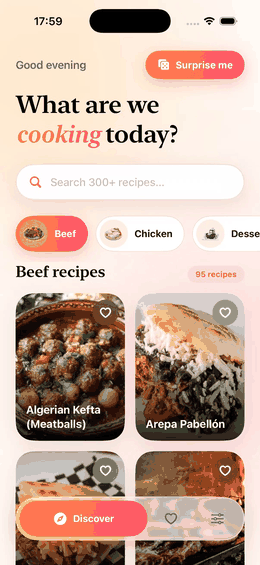
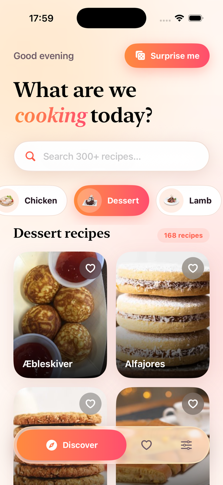
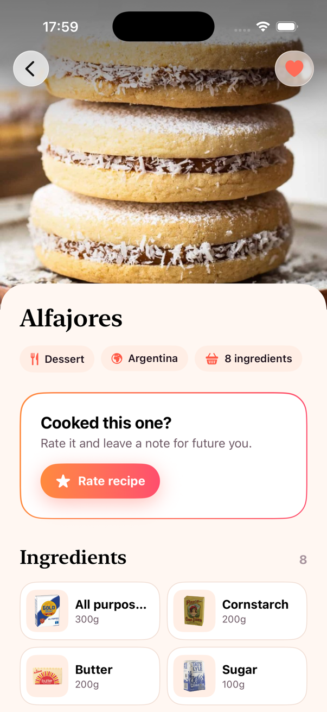
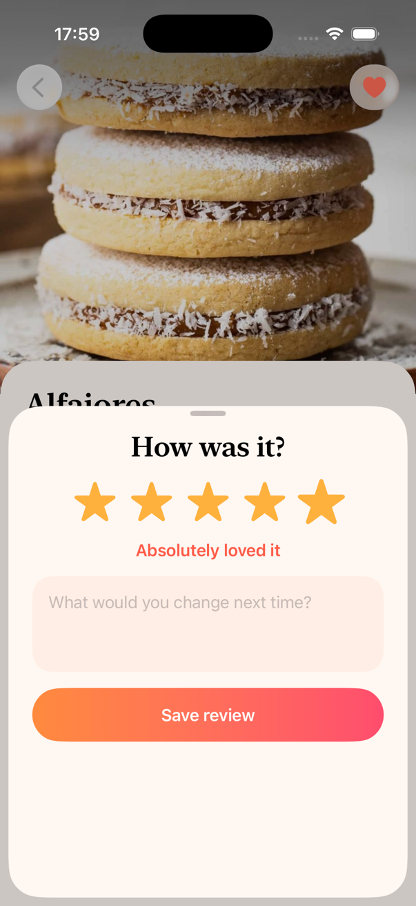

# Savora for iOS

A native SwiftUI recipe explorer built as an architecture showcase. It browses
[TheMealDB](https://www.themealdb.com/api.php) (public, no API key), lets you
save recipes and rate/review them, works offline from cache, and ships in
English and Serbian with light and dark themes.

Savora exists in four stacks with the same features, design and behaviour, so
the code can be compared side by side:

| Flutter | **iOS (this repo)** | Android | React Native |
| :---: | :---: | :---: | :---: |
| [savora](https://github.com/LugonjaAleksandar/savora) | SwiftUI · Swift 6 | [savora-android](https://github.com/LugonjaAleksandar/savora-android) | [savora-react-native](https://github.com/LugonjaAleksandar/savora-react-native) |

## Demo

<p align="center">
  
</p>

A 20-second walkthrough recorded on the iPhone 17 Pro simulator (iOS 26), with the pauses between taps cut out. It shows the sliding category picker, the native zoom transition into a recipe, a 5-star review, swipe-to-remove with undo on the Saved tab, and a live switch to dark mode and Serbian. A sharper version is in [`docs/showcase.mp4`](docs/showcase.mp4).

| Discover | Recipe | Review | Settings (dark, Serbian) |
| :---: | :---: | :---: | :---: |
|  |  |  |  |

## Features

- **Discover**: category chips with a sliding gradient selector, a debounced search pinned under the header, a 2-column grid with staggered entrance animations, pull to refresh and a "Surprise me" random pick.
- **Recipe detail**: the grid card zooms into the recipe (`navigationTransition(.zoom)`), a stretchy header image, ingredient tiles, a step-by-step timeline, and YouTube/source links.
- **Rate & review**: 1–5 stars plus a note in a sheet. Stored on the device, with edit and delete.
- **Saved**: favourites persisted with their full summary, so the tab renders offline. Swipe to remove, with undo.
- **Settings**: theme (system/light/dark) and language (system/English/Srpski), both persisted and applied instantly. The first launch is in English.
- **Liquid Glass**: the floating tab bar and toolbar buttons use `glassEffect` on iOS 26, with a material fallback on iOS 18.
- **Offline-first caching**: see [Caching](#caching).

No third-party dependencies: networking, image caching, persistence and localisation all use the platform.

## Running

Requires Xcode 26 (Swift 6.2). The app targets iOS 18 and later.

```bash
open Savora.xcodeproj
```

Or from the command line:

```bash
xcodebuild test -project Savora.xcodeproj -scheme Savora -destination 'platform=iOS Simulator,name=iPhone 17 Pro' -parallel-testing-enabled NO
```

The project builds in the Swift 6 language mode with complete concurrency checking and warnings treated as errors. CI runs the same build and tests (`.github/workflows/ci.yml`).

## Architecture

Code is organised by feature. Each feature keeps its models, data access, state and views together:

```
Savora/
├── App/                  # composition root, router, app shell (tabs + toasts)
├── Core/
│   ├── Networking/       # APIClient, HTTPTransport seam, AppFailure
│   ├── Storage/          # KeyValueStore protocol (UserDefaults / in-memory)
│   ├── Localization/     # Localizer over the String Catalog
│   └── DesignSystem/     # tokens, glass, buttons, shimmer, FlowLayout, SlidingSelector
├── Features/
│   ├── Meals/            # models, remote data source, cache, repository
│   ├── Discover/         # DiscoverRoute + view model + cards and chips
│   ├── MealDetail/       # MealDetailRoute + view model + ingredient tiles
│   ├── Reviews/          # review model, repository, section and sheet
│   ├── Favorites/        # FavoritesStore, Saved route and tiles
│   └── Settings/         # SettingsStore and route
└── Resources/            # Localizable.xcstrings (en, sr), assets
SavoraTests/              # Swift Testing suites + test doubles
```

Data flows one way:

```
View ──intent──▶ @Observable model ──▶ Repository (protocol) ──▶ RemoteDataSource ──▶ APIClient ──▶ HTTPTransport
 ▲                     │                       └──────────────▶ MealsCache ──▶ KeyValueStore
 └────── state ────────┘
```

### Key decisions

| Decision | Why |
| --- | --- |
| **Constructor injection from one composition root (`AppContainer`).** | No view or model reaches for a singleton. Every type can be built in a test with fakes, and its dependencies are visible in its initializer. |
| **Repositories are protocols; models depend only on the protocol.** | Tests use in-memory or fake implementations, and swapping local storage for a backend would not touch view models or views. |
| **Typed throws: `async throws(AppFailure)`.** | Failures are a closed enum, so every `catch` is exhaustive and the UI maps them to localised copy, never to raw error messages. |
| **`@Observable` + `@MainActor` view models; Swift 6 strict concurrency.** | Views re-render only for the properties they read, and data races are compile-time errors rather than runtime crashes. |
| **Restartable loads.** Every load cancels the previous `Task`, and search waits 350 ms before hitting the network. | A slow response can never overwrite a newer selection, and typing does not fire a request per keystroke. |
| **Only route-level screens navigate.** Cards and tiles expose `onTap`; `DiscoverRoute`, `FavoritesRoute` and `MealDetailRoute` push routes, present sheets and open links. | Components stay reusable and previewable, and navigation is easy to follow. |
| **One `NavigationStack` above the tabs with typed `Route`s.** | A pushed recipe covers the floating tab bar, the zoom transition works from both the grid and the Saved list, and every tab keeps its state. |
| **List items in their own files** (`MealCard`, `CategoryChip`, `FavoriteTile`, `IngredientTile`). | Each one is easy to find, preview and reuse. |
| **Design tokens resolve per trait collection.** | Views never branch on light/dark, and the theme switch is a single `preferredColorScheme`. |

### Caching

`LiveMealsRepository` uses a different strategy for each kind of data:

| Data | Strategy | TTL |
| --- | --- | --- |
| Categories | cache-first | 1 day |
| Meal detail | cache-first (also warmed by "Surprise me") | 7 days |
| Category listing | network-first, stale cache on `AppFailure.network` | — |
| Search | network only | — |

`MealsCache` stores Codable values with a timestamp. If an entry is corrupt, it is dropped instead of crashing. Images go through a 256 MB `URLCache`, so photos render offline once seen.

### Localisation

Copy lives in `Resources/Localizable.xcstrings` and is generated from the same ARB files as the Flutter app, so all four apps say exactly the same thing. Plural variations cover Serbian's `one/few/other` forms ("1 recept", "3 recepta", "5 recepata"). `Localizer` resolves strings from the language bundle picked in Settings, independent of the device language, and dates are formatted with the matching locale.

## Testing

28 tests in 8 suites, written with Swift Testing, run in under a second and need no network:

- `APIClient`: URL building, and mapping 404/5xx/bad JSON/offline/timeouts to typed failures (parameterised).
- `LiveMealsRepository`: cache TTL hits and expiry, offline fallback, server errors not being masked by cache, cache warming by the random pick, and corrupt entries being dropped.
- `DiscoverViewModel`: initial load, category switching, **search debouncing** (only the last query reaches the repository), clearing a search, and the failure path.
- `MealDetail`: flattened ingredient parsing, step splitting, blank-field normalisation and a cache round trip.
- `FavoritesStore`, `MealReviewModel`: persistence round trips and the undo position.
- `LocalSettingsRepository`: English on first launch, and an explicit "System" choice being remembered.
- `Localizer`: Serbian and English plural forms, and Serbian dates in Latin script (`sr-Latn`) to match the copy.

Network tests replay canned responses through a `StubTransport`, and storage-backed tests use `InMemoryKeyValueStore`.

## Possible next steps

- Snapshot tests for the design-system components.
- Widgets and App Intents for the random pick.
- Syncing reviews to a backend through a remote `ReviewsRepository`.

---

Data and images © [TheMealDB](https://www.themealdb.com).
